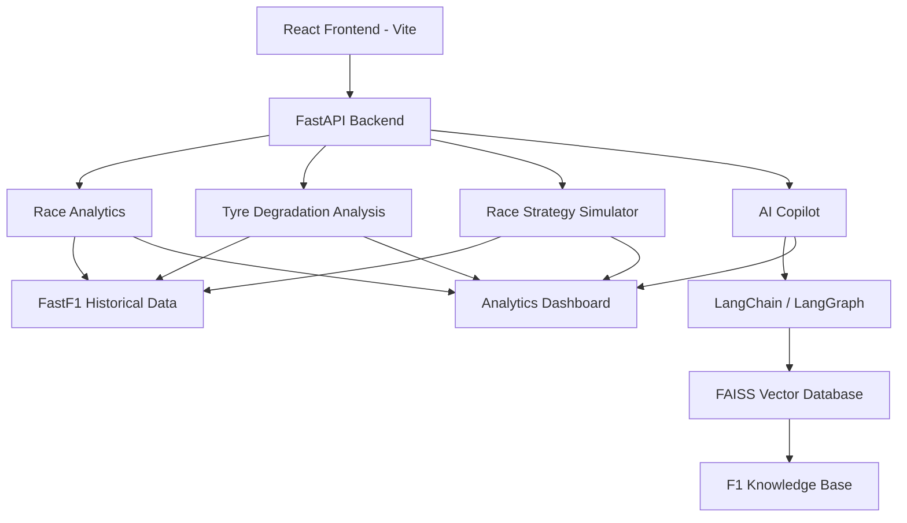

# 🏎️ Apex Intelligence AI

### AI-Powered Formula 1 Race Analytics & Strategy Intelligence Platform

Apex Intelligence AI is an intelligent Formula 1 analytics platform designed to transform race telemetry and historical racing data into actionable insights. It combines data analytics, machine learning, Retrieval-Augmented Generation (RAG), and race strategy simulation to help users understand driver performance and explore race strategies.

The platform brings together interactive race analytics, an AI-powered F1 Copilot, tyre degradation analysis, and a custom race strategy simulator in one dashboard.

---

## 🚀 Key Features

### 1. Race Analytics Dashboard
- Compare two Formula 1 drivers.
- Analyze lap-time performance.
- Visualize driver pace and lap-time trends.
- Explore race-specific telemetry and performance insights.

### 2. AI-Powered F1 Copilot
- Conversational interface for Formula 1-related questions.
- Retrieval-Augmented Generation (RAG) for context-aware responses.
- FAISS-based vector search for retrieving relevant F1 knowledge.
- LangChain and LangGraph-based AI workflows.

### 3. Tyre Strategy Intelligence
- Compare tyre strategies across drivers.
- Analyze tyre degradation patterns.
- Explore compound performance across race stints.
- Understand the impact of tyre age on lap times.

### 4. Race Strategy Optimizer
- Generate estimated race strategies using historical performance data.
- Compare alternative pit-stop strategies.
- Evaluate tyre compound choices.
- Simulate future stints based on pace and degradation estimates.

### 5. Custom Strategy Builder
- Create custom race strategies.
- Add and configure individual stints.
- Select tyre compounds and stint lengths.
- Evaluate custom strategies against optimizer recommendations.
- Visualize strategy comparisons.

### 6. Interactive Dashboard
- Dark-themed Formula 1-inspired interface.
- Interactive driver and race selection.
- Data visualizations and strategy comparison charts.
- Integrated analytics and AI Copilot experience.

---

## 🛠️ Technology Stack

| Category | Technologies |
|---|---|
| Programming Language | Python, JavaScript |
| Frontend | React.js, Vite |
| Backend | FastAPI |
| F1 Data | FastF1 |
| AI / LLM | LangChain, LangGraph |
| RAG | FAISS, Vector Embeddings |
| Data Processing | Pandas, NumPy |
| Testing | Pytest |
| Development Tools | Git, GitHub, VS Code |

---

## 🏗️ System Architecture



---

## 📂 Project Structure

```text
apex-intelligence-ai/
│
├── frontend/
│   ├── src/
│   │   ├── components/
│   │   │   └── StrategySimulator.jsx
│   │   ├── App.jsx
│   │   └── App.css
│   └── package.json
│
├── src/
│   └── apex/
│       ├── api.py
│       ├── analytics.py
│       └── strategy_simulator.py
│
├── tests/
│   └── test_strategy_simulator.py
│
├── .venv/
├── README.md
└── requirements.txt
```

---

## ⚙️ Installation & Setup

### Prerequisites

- Python 3.10+
- Node.js and npm
- Git

### 1. Clone the repository

```bash
git clone https://github.com/Garvsri/apex-intelligence-ai.git

cd apex-intelligence-ai
```

### 2. Set up the Python environment

```bash
python -m venv .venv
```

Activate the environment:

**Windows PowerShell**
```powershell
.\.venv\Scripts\Activate.ps1
```

Install backend dependencies:

```bash
pip install -r requirements.txt
```

### 3. Start the backend

```powershell
$env:PYTHONPATH = "$PWD\src"
uvicorn apex.api:app --reload
```

The backend will run at:

`http://127.0.0.1:8000`

FastAPI documentation:

`http://127.0.0.1:8000/docs`

### 4. Set up the frontend

Open a new terminal:

```bash
cd frontend
npm install
npm run dev
```

The frontend will run at the local URL displayed by Vite, typically:

`http://localhost:5173`

---

## 🧪 Running Tests

Run the backend test suite from the project root:

```bash
pytest -v
```

The project has achieved **51 passing tests** in its current test suite.

---

## 📊 Strategy Simulation Methodology

The race strategy simulator estimates stint performance using tyre compound characteristics, driver pace offsets, and tyre degradation.

The simplified lap-time model is:

\[
T_{\text{lap}} =
T_{\text{compound}} +
T_{\text{driver}} +
D_{\text{compound}}(A-1)
\]

Where:

- \(T_{\text{compound}}\): Baseline lap time for the tyre compound.
- \(T_{\text{driver}}\): Driver-specific pace adjustment.
- \(D_{\text{compound}}\): Estimated tyre degradation per lap.
- \(A\): Tyre age in laps.

The optimizer uses estimated stint costs and configurable pit-stop losses to compare possible strategies.

**Note:** Strategy outputs are estimates, not guaranteed race outcomes. The current simplified model does not fully account for changing weather, traffic, fuel load, safety cars, track evolution, or tyre-set availability.

---

## 🔬 Testing & Validation

The project includes automated tests covering:

- Race analytics.
- Data loading and ingestion.
- Dataset manifests.
- Tyre degradation analysis.
- Race strategy simulation.
- Custom strategy evaluation.

Latest recorded test result: **51 passed**.

---

## 🔮 Future Improvements

- Real-time race telemetry integration.
- Weather-aware strategy optimization.
- Safety Car and Virtual Safety Car scenario simulation.
- Traffic and undercut/overcut analysis.
- More advanced machine learning models for lap-time prediction.
- Enhanced strategy recommendations using historical race outcomes.
- Cloud deployment and public demo.

---

## 👨‍💻 Author

**Garv Srivastava**

Computer Science Engineering Student | AI/ML Developer

- GitHub: [@Garvsri](https://github.com/Garvsri)

---

## ⭐ Support

If you find this project interesting, consider giving the repository a star!

**Apex Intelligence AI — Turning Formula 1 Data Into Race Strategy Intelligence.** 🏁
